# WSJT-SWISS 3 window reference

[English manual](Manual-English.md) · [Deutsch](Anleitung-Deutsch.md) · [Français](Manuel-Francais.md) · [Italiano](Manuale-Italiano.md)

This reference covers the contest workflow, settings and the additional windows inherited from WSJT-X. The application menus keep their English names. Windows file-dialog buttons follow your Windows language. Screenshots use a separate demonstration profile without a radio; blank spectrum displays are expected.

## Starting the program

### First start

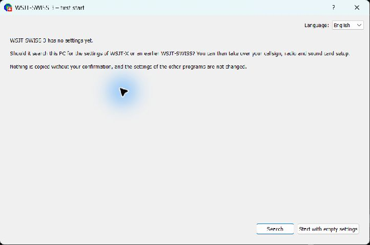

This appears when the profile has no settings. Choose the language at the top. **Search** looks for WSJT-X and earlier WSJT-SWISS profiles; **Start with empty settings** continues without copying one. Searching does not change another application's settings. In the results page, select a profile, check its callsign, radio, audio devices and file location, then choose **Import selected**. The confirmation reports the source. If nothing is found or copying fails, continue with empty settings and configure the station with F2.

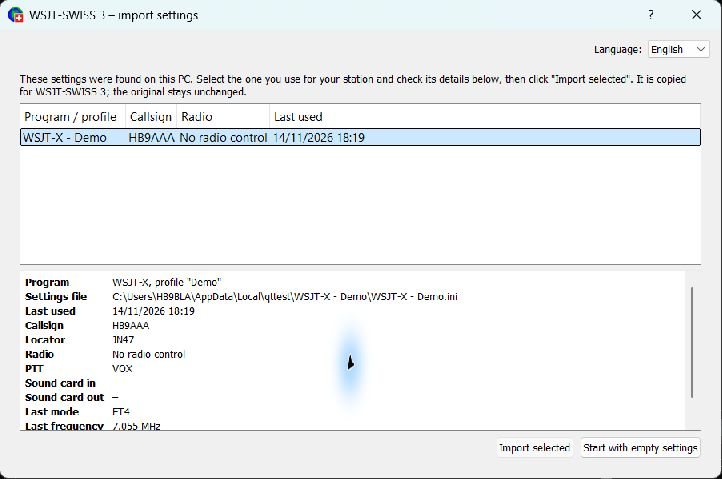

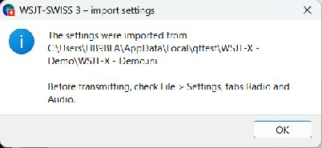

### Canton selection

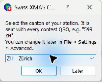

Select the canton where the station is operating and choose **OK**. The code is sent in the exchange. **Later** postpones the choice; set the canton under **Settings → Advanced** before contest operation. OK is disabled until a canton is chosen.

## Operating and logging

### Main window

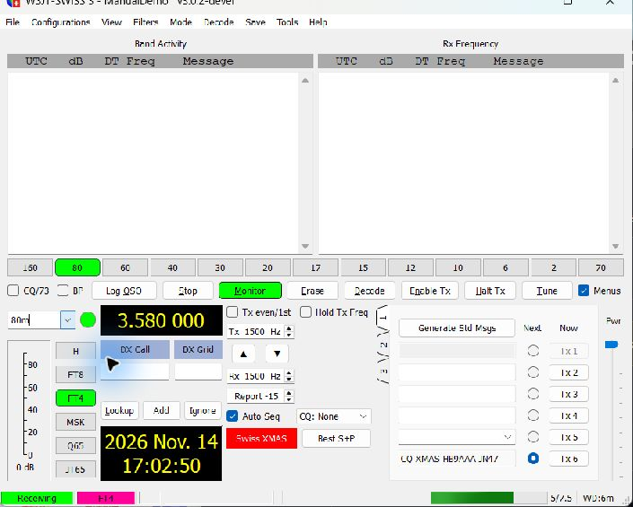

The left **Band Activity** pane lists decoded stations across the passband. **Rx Frequency** on the right follows the selected receive frequency. The frequency dropdown selects the radio dial frequency; **Tx** and **Rx** set audio offsets within the passband. Choose **FT4**, then **3.580 MHz** or **7.055 MHz**, labelled **Swiss** in the list.

**Monitor** receives, **Decode** retries decoding, and **Erase** clears the displayed text. **Enable Tx** allows transmission and **Tune** sends a tuning signal. **Halt Tx** stops transmission. Double-clicking a decoded callsign can enable transmission when that option is checked in General settings. Check the radio, audio path, canton and frequency before operating.

The message tabs provide standard messages, free text and additional operating controls. **Generate Std Msgs** rebuilds the standard exchange after changing the DX callsign. **Auto Seq** advances the exchange. The status bar shows the mode, receive/transmit state and watchdog. **Menus** restores the menu bar if it has been hidden.

### Contest Log

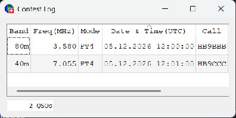

Open **View → Contest log**. Each row shows band, frequency, mode, UTC time, callsign and exchanges. The count below the table is the number of contest QSOs. Scroll horizontally to see all columns. Right-click for the available editing actions. This is the log used by **Submit log to USKA**; check it before submitting.

### Log QSO

If the DX callsign is missing, the program warns before continuing to the form. Invalid sent/received exchanges produce a separate warning; correct them before accepting.

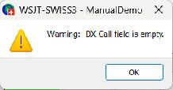

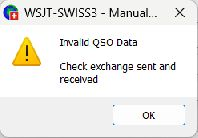

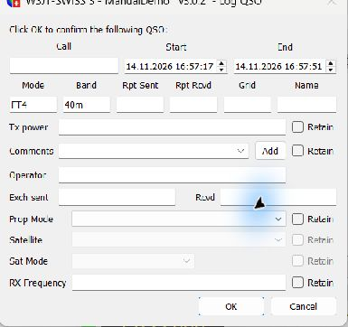

**Log QSO** on the main window opens the contact form when manual logging is needed. Check callsign, locator, date/time, frequency, mode and sent/received reports, then accept to record the QSO. Cancel leaves the contact unlogged. In Swiss XMAS operation, the default automatic logging records the canton exchange without requiring this form for each completed QSO.

### A new contest day

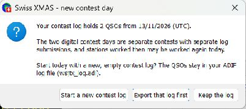

When the current contest log still contains contacts from an earlier UTC day, the program asks whether to start a new one. **Export that log first** opens the export form, then returns to this question. **Start a new contest log** clears the contest table for the new day. **Keep the log** leaves it unchanged. The ADIF file retains the QSOs. The two digital contest days need separate entries; preserve the old day's log before clearing it.

### Change Operator

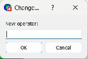

**Alt+O** opens this input box. Enter the operating callsign and choose OK, or Cancel to retain the previous operator. This is separate from the station callsign in General settings.

## Settings (F2)

**OK** validates and saves settings; **Cancel** discards the changes made in this visit. Some changes require a restart, as indicated beside the control. Click a tab below to find the relevant controls.

### General

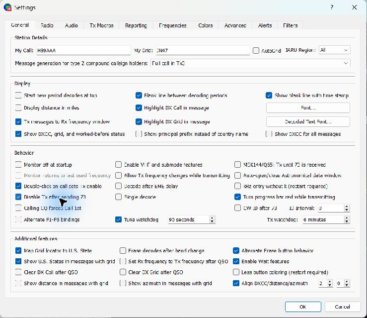

Set **My Call**, **My Grid** and the IARU region (Region 1 for Switzerland). Display controls set fonts, decoded-message layout and worked-before information. Enable **Show DXCC, grid, and worked-before status** to use the corresponding highlighting rules. Behavior controls include double-click transmission, stopping after 73 and watchdog limits. The Font buttons open the standard font chooser; select family, style and size, then OK or Cancel.

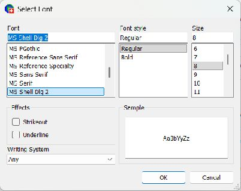

### Radio

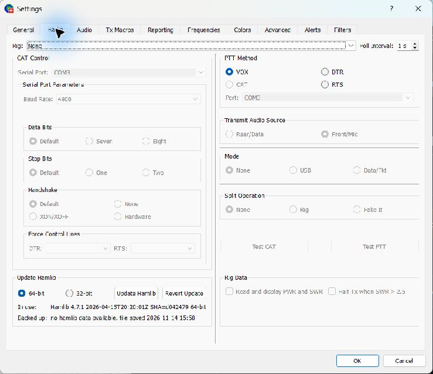

Choose the rig, CAT port/network address, serial parameters, PTT method, audio source, data mode and split method appropriate to the station. **Test CAT** checks rig control. **Test PTT** can key the transmitter. **None** is suitable for this demonstration profile, not a complete station configuration. **Update Hamlib** and **Revert Update** manage the radio library; their prompts report the download, verification and restart requirements.

### Audio

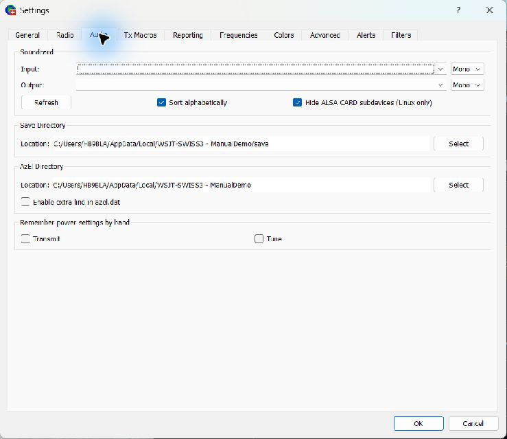

Choose the radio's audio **Input** and **Output**, with the correct channels. **Refresh** reloads the device list. The two **Select** buttons open directory choosers for saved audio and astronomical data; these are separate from the contest log directory. Optional checkboxes remember transmit and tune power by band.

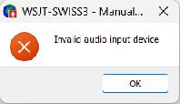

An invalid input/output warning means the selected device is unavailable or no device has been selected. Reconnect the interface, use Refresh and select the correct devices. The form stays open so the selection can be corrected. The demonstration computer has no configured audio devices.

### Tx Macros

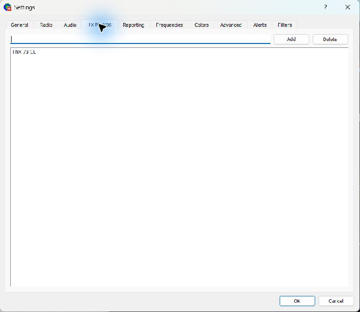

Enter a short message and use **Add** to store it; select an existing entry and use **Delete** to remove it. These macros populate the free-message selector. They do not replace the automatic Swiss canton exchange.

### Reporting

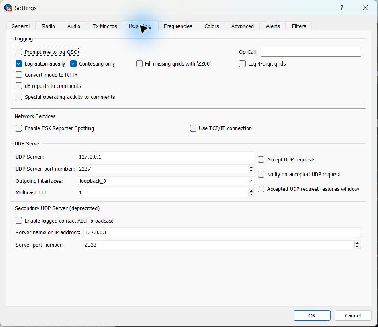

The logging controls choose automatic logging or a confirmation prompt, with **Contesting only** limiting automatic logging to contest operation. The network section configures PSK Reporter, the UDP server and contact broadcasts for external programs. Keep these disabled unless the service or external logger is needed. The confirmation email for USKA submission is entered in the submission workflow, not on this tab.

### Frequencies

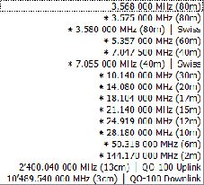

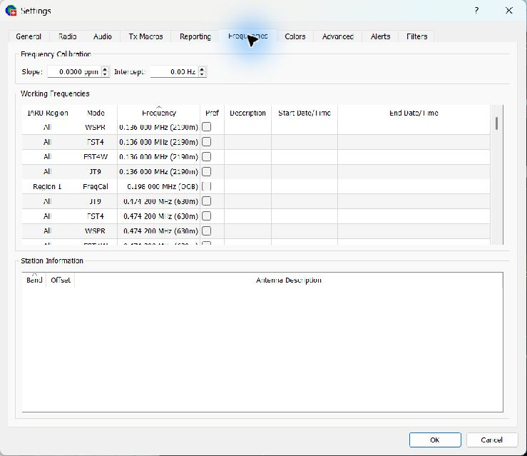

The upper table stores working frequencies by IARU region and mode. The Swiss contest entries are FT4 at **3.580 MHz** and **7.055 MHz**. A description appears in the dropdown. Double-click a cell to edit it. Right-click **Insert** to open the frequency form; choose region, mode, frequency in MHz, description and preference, then OK. Cancel adds nothing.

The context menu also loads, merges, saves and resets frequency lists. **Load** can replace the current list; **Merge** adds entries. Reset returns to shipped defaults and asks for confirmation. The lower station table stores antenna descriptions and offsets; its Insert dialog asks for the band's station information. File operations use frequency-list files (`.qrg` or `.qrg.json`).

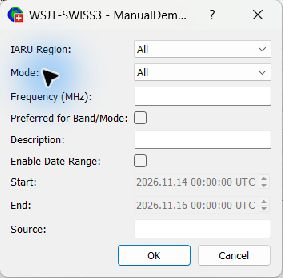

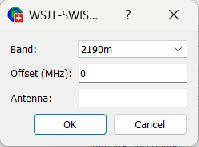

### Colors

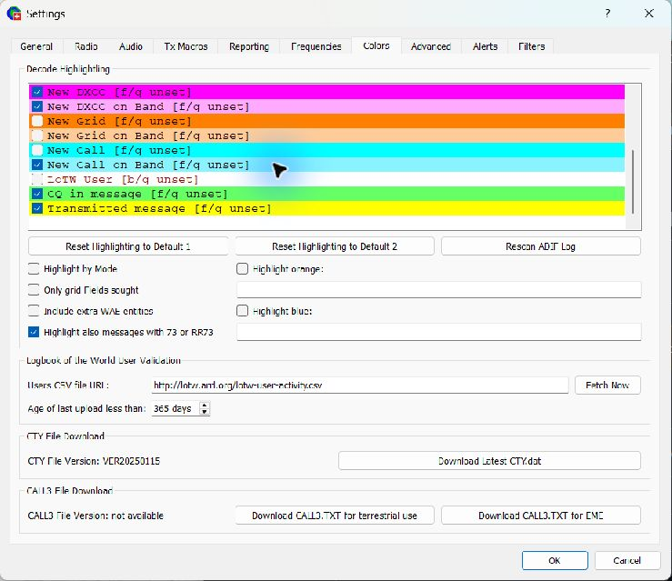

**New Call on Band** is checked in the default scheme. Drag rules to change their priority. Right-click a rule to change foreground/background colors in the color chooser, or to adjust its treatment. **Reset Highlighting** restores the shipped defaults. Existing/imported saved choices are retained, including a disabled New Call on Band rule. Worked-before highlighting reads the ADIF log; use **Rescan ADIF Log** after replacing that file.

The orange/blue callsign and locator lists identify wanted stations. **Highlight by Mode** makes worked-before checks mode-specific. **View → Color highlighting scheme** opens a compact legend of the active colors.

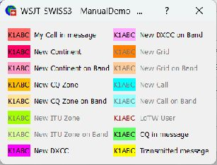

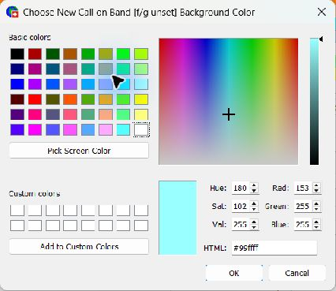

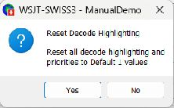

### Advanced

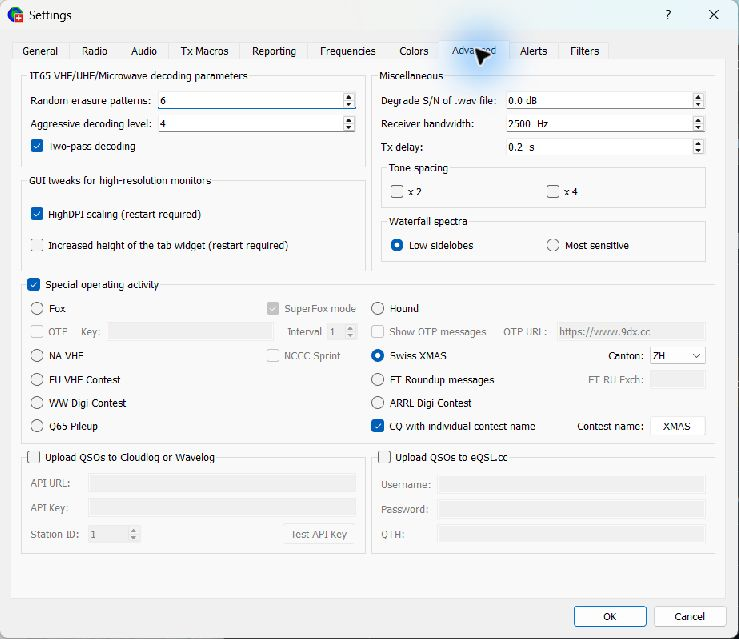

Under **Special operating activity**, select **Swiss XMAS** and the station's **Canton**. **CQ with individual contest name** uses **XMAS** for the contest CQ. Other controls cover decoding, timing, display scaling and optional external logging services. For normal non-contest contacts, disable Special operating activity. Do not enter another contest's exchange in place of the canton.

### Alerts

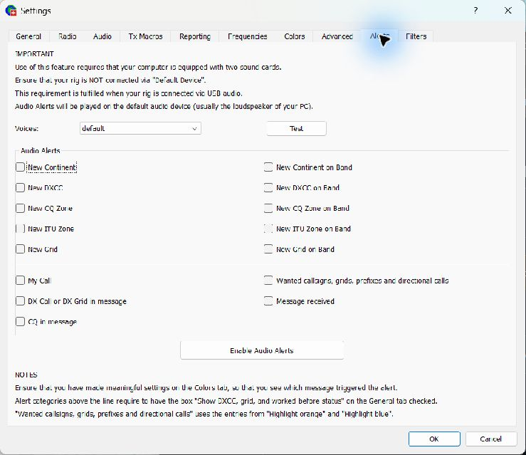

Select which decoded events should produce spoken alerts, choose a voice, and use **Enable Audio Alerts** to enable them. The text on this tab explains the separate audio-device requirement. These alerts are independent of the Colors highlighting rules.

### Filters

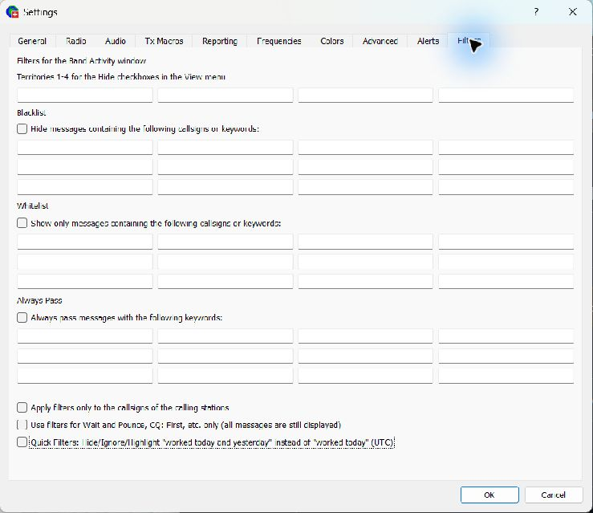

Blacklist hides matching callsigns/keywords; whitelist limits the display to matches; Always Pass provides exceptions. Other options limit filtering to callers or automatic response selection. These can hide valid contest stations, so check them if a decoded station seems to disappear. The quick filters in the Filters menu control worked-before and ignored stations.

## Submission and optional export

### Submit log to USKA: station details

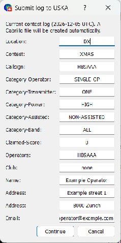

Choose **File → Submit log to USKA …**. The first window identifies the current contest log by UTC date and shows the remembered Cabrillo header details. Review name, address, email and category information. **Continue** generates the file and opens submission; **Cancel** stops before generating it. An empty log is blocked, and a missing callsign or email must be corrected first. The station callsign is read-only here; change it in General settings if necessary.

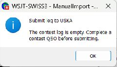

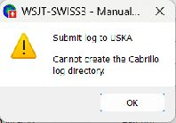

If the file cannot be created, dismiss the warning, correct the directory/access problem and try Continue again. The details form remains open and submission does not start.

### Submit log to USKA: declaration

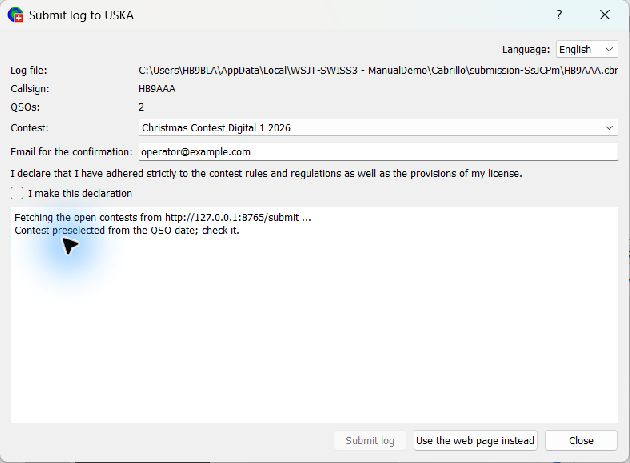

This and the portal-result examples below use a local test portal and fictitious station details. They show the application's behavior; no log was submitted to USKA and no email was sent.

The next window shows the generated filename, station callsign, QSO count, contest selector and email address. Choose a language at the top if required. Check the contest even if it was preselected from the QSO date. **Submit log** becomes available after choosing a contest, entering an email and accepting the declaration. **Close** leaves the generated local file available without sending it. **Use the web page instead** opens the portal in the browser.

The status area first reports the list of open contests. If none is available, the contest may not yet be open for submissions. Retry when the portal accepts that contest. An unavailable portal or network error is reported here; no manual export is needed to retry from the current log.

### Portal warnings, rejection and receipt

Portal warnings are listed in the status area. A separate question offers **Submit anyway** or **Cancel**. Review the warnings: invalid QSOs may reduce the score. A rejection stops submission and asks you to correct the log and generate it again. After success, the status area and a receipt message identify the contest, category and confirmation email. The email with the log attached is the official receipt.

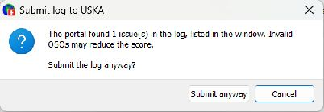

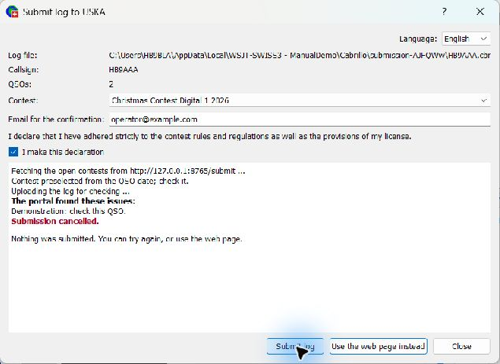

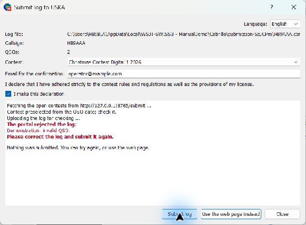

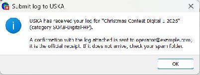

If confirmation is uncertain after the final request, the program says the log may have been received. Check the confirmation email and spam folder before trying again. A success screen produced with the local demonstration fixture is labelled as such in the screenshot inventory; it does not represent an entry at USKA.

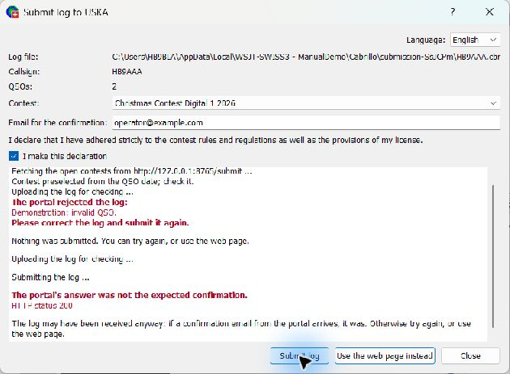

### Export Cabrillo log (optional)

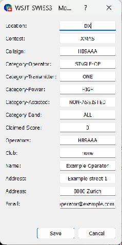

**File → Export Cabrillo log …** opens the full header form. It supplies Swiss XMAS defaults and remembers edits. **Save** opens the standard Save Log File dialog, filtered to `.cbr`. Choose the destination and filename; the default starts in the WSJT-SWISS log directory, then remembers successful manual export folders. An overwrite prompt protects an existing file. Cancel returns to the details form. A write error leaves the form open for correction.

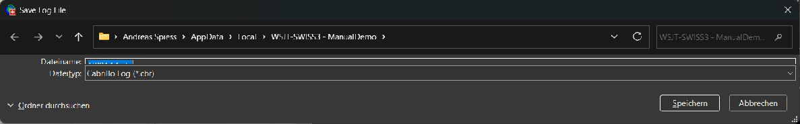

After saving, **Submit to USKA now** sends that file through the declaration window, **Open submission page** opens the browser, and **Later** keeps only the local copy. The normal Submit log action creates a new file automatically instead of asking for one.

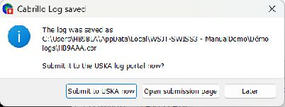

## Additional display windows

These are inherited WSJT-X tools. They are not required for the Swiss HF FT4 contest. Closing a display does not erase the log.

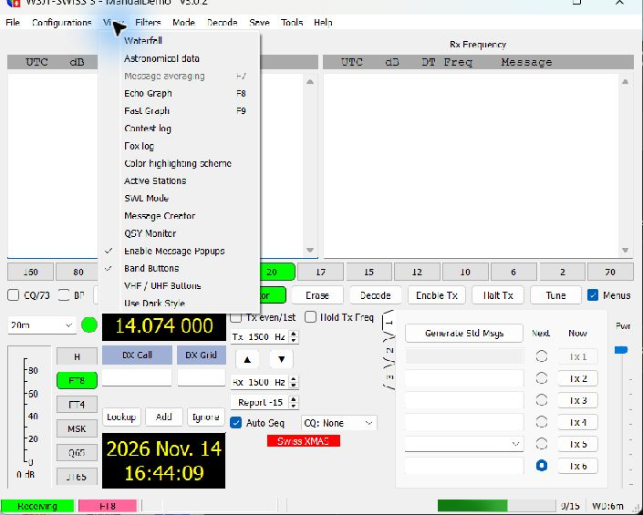

### Wide Graph / Waterfall

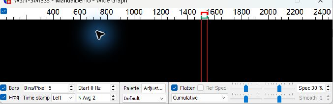

Open **View → Waterfall**. Frequency runs horizontally and successive receive periods run vertically. Set the visible range with start frequency and bins/pixel, and adjust gain, averaging, spectrum mode and palette. Receive/transmit markers show audio offsets. The controls checkbox hides or shows the control panel.

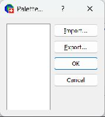

**Adjust…** opens Palette Designer. The table edits palette colors; **Import…** and **Export…** open palette file dialogs. OK applies the palette; Cancel keeps the existing one. A color cell opens the standard color chooser.

### Astronomical Data

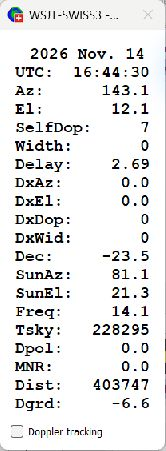

Open **View → Astronomical data**. This is an EME display of time, Moon/Sun pointing, Doppler and propagation-related values. Doppler tracking controls appear when applicable. It is unrelated to canton exchange.

### Echo Graph

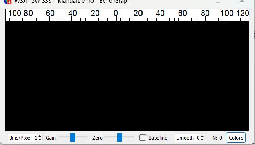

Open **View → Echo Graph (F8)**. This plots echo measurements for EME work. The bottom controls adjust scale, gain, zero level, smoothing and colors. It remains empty without echo measurements.

### Fast Graph

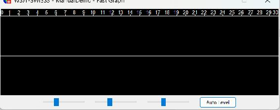

Open **View → Fast Graph (F9)**. This displays time-domain receive data for fast modes. The sliders adjust the display, **Auto Level** sets its level automatically, and **Limits** controls the range. It is not the FT4 waterfall.

### Message Averaging

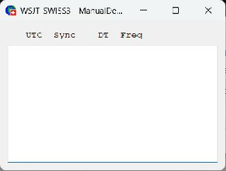

Open **View → Message averaging (F7)** in a supported JT4/JT65 mode with VHF features enabled. The table lists accumulated decoding information; clearing the averaging data does not delete contest contacts. A disabled menu entry means the current mode/settings do not use this window.

### Fox Log

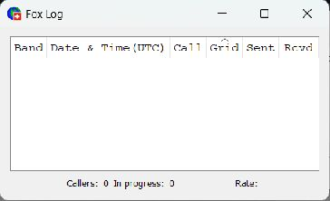

Open **View → Fox log**. This table and its queue/rate counters support FT8 DXpedition Fox operation. It is separate from the Swiss Contest Log and is not the log submitted for Swiss XMAS.

### Active Stations

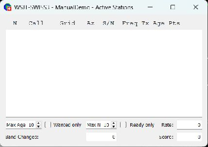

Open **View → Active Stations**. This lists decoded stations with callsign, locator, direction, signal, frequency and age. The controls limit age/count and wanted/ready stations. It can be empty when there are no applicable decodes.

### Message Creator and QSY Monitor

**View → Message Creator** prepares frequency-change messages using its HF, VHF, EME and General tabs. Choose the band/mode and message parameters, then review the generated text. **Send Message** can initiate transmission; this tool is not needed for normal Swiss contest exchanges. **Save** stores its configuration. If an IARU region warning appears, set the region in General settings to populate regional frequencies.

**View → QSY Monitor** lists received QSY messages with UTC time, callsign, frequency and mode. **Clear** clears this display. **View → Enable Message Popups** controls whether received messages also open a small Message window; its title carries the UTC time. Read the proposed change before acting on it.

**Reply Yes** and **Reply No** prepare and transmit a reply; closing the window sends nothing. The example above was decoded from a generated audio file with no radio connected.

## File, configuration, help and maintenance dialogs

The **Configurations** menu switches between saved station configurations. **Clone**, **Clone Into…**, **Rename…**, **Reset** and **Delete** open a name/profile chooser or a confirmation. Check the named configuration before accepting. Cancel keeps the existing selection. These are configuration operations, not selection of a contest day for submission.

**File → Open… (Ctrl+O)** selects saved audio to decode. This is not a contest-log import. **Open next** and **Decode remaining files** process neighboring audio files. Standard file/directory dialogs also appear for audio-save folders, frequency lists, palette files and optional exports. Check the title and file filter before choosing a file. Cancel changes nothing in the corresponding operation.

Commands to erase logs, remove saved audio, reset the Cabrillo log, clear a reference spectrum or reset a configuration show confirmation dialogs. Read the filename or target shown in the question. Accept only when that is the data you intend to clear; Cancel/No keeps it. **Reset Cabrillo log** affects the contest log; erasing `wsjtx_log.adi` affects the ADIF log and worked-before information.

**Tools → Equalization tools…** displays phase-response measurements and related controls. It is intended for calibration, not contest submission. Missing calibration data and calibration calculations are reported in message boxes. Other Tools commands measure or clear reference/phase-response data; follow their prompts before changing calibration.

**Help → Download Samples…** opens the sample-audio downloader. Select the required sample files and download destination; progress and errors are shown in that window. About, Copyright notice, keyboard/mouse commands and release notes show version/licence or read-only help text. Online and local user-guide commands open documentation in the browser.

Startup or operating failures use the same message-box family as the audio warning above. The text identifies the failing item: radio/CAT, audio device, data directory, database, decoder subprocess/shared memory, network or file. **Retry** repeats the named operation; **Cancel** stops it. Record the complete message and application version when reporting a problem. Do not resolve a log/database error by deleting the station's files.

